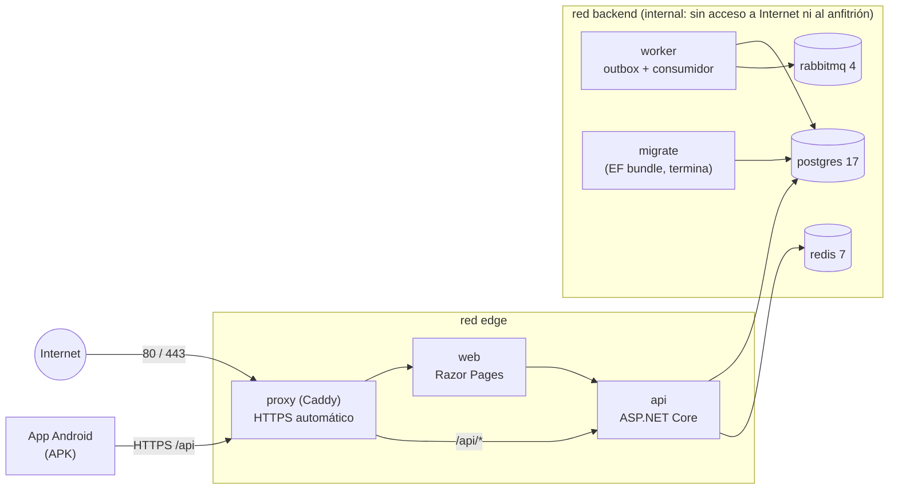

# MediCore · Contenedores e infraestructura de QA (entrega 8)

Estado: **preparado y verificado en local; NO desplegado en Azure.** No se ejecutó `terraform apply`, no se creó ningún recurso de pago ni se publicó ningún servicio. El despliegue real espera la aprobación del plan y del costo de la sección 3.

## 1. Arquitectura

Un monolito modular en contenedores (sin microservicios): la API, la web, un proceso de mensajería (worker) y tres dependencias, detrás de un proxy inverso. La app Android es un APK: **no** es un servicio del Compose.



| Servicio | Imagen | Puertos publicados | Salud | Persistencia |
|---|---|---|---|---|
| `postgres` | `postgres:17-alpine` | ninguno | `pg_isready` | volumen `postgres-data` |
| `redis` | `redis:7-alpine` (con contraseña) | ninguno | `redis-cli ping` | volumen `redis-data` |
| `rabbitmq` | `rabbitmq:4-management-alpine` (nodo fijo `medicore-rabbitmq`) | ninguno | `rabbitmq-diagnostics ping` | volumen `rabbitmq-data` |
| `migrate` | `docker/migrator.Dockerfile` (paquete `efbundle`) | — | termina con código 0 | — |
| `api` | `docker/api.Dockerfile` | ninguno | `GET /api/health/ready` (consulta PostgreSQL) | — |
| `worker` | `docker/worker.Dockerfile` | ninguno | latido en `/tmp/medicore-worker.alive` | — |
| `web` | `docker/web.Dockerfile` | ninguno | `GET /Login` | volumen `web-keys` (claves de la cookie de sesión) |
| `proxy` | `caddy:2-alpine` | 80 y 443 (local: 127.0.0.1:8080 y 8443) | `GET /api/health` | volúmenes `caddy-data`, `caddy-config` (certificados) |

Decisiones:
- **Se reutilizó el `docker-compose.yml` existente** (dependencias con su salud y volúmenes). `docker-compose.qa.yml` se superpone: quita los puertos publicados (`ports: !reset []`), agrega las redes y los servicios de la aplicación. El nombre de proyecto `medicore-qa` crea volúmenes propios (`medicore-qa_*`): el desarrollo (`medicore_*`) no se toca.
- **Proceso de mensajería = `MediCore.Worker`** (proyecto nuevo, sin HTTP): es el mismo código de `MediCore.Infrastructure` (publicador del outbox y consumidor de `LabResultReady`). En QA la API corre con `Messaging__Enabled=false` y solo guarda el evento en el outbox; el worker lo publica. En desarrollo (`dotnet run`) todo sigue dentro de la API.
- **Configuración solo por variables de entorno** (`.env.qa`, ignorado por Git; `.env.qa.example` documenta cada variable). Nada de secretos en imágenes ni en el repositorio. Las imágenes corren con usuario sin privilegios.
- **Detrás del proxy:** la API y la web leen `X-Forwarded-For/Proto` (`ForwardedHeaders__Enabled`), de modo que el límite de intentos de inicio de sesión y la auditoría ven la IP real del cliente. Es seguro porque solo el proxy llega a ellas.
- **Claves de la cookie de sesión de la web** en un volumen: sobreviven a los reinicios (sin esto, cada reinicio cerraba todas las sesiones).

### Orden de arranque y migraciones
`postgres`, `redis`, `rabbitmq` (saludables) → `migrate` (aplica las migraciones pendientes y termina; es idempotente y toma un bloqueo exclusivo, así que reintentar o correr dos veces es seguro) → `api` y `worker` (saludables) → `web` → `proxy`. Las migraciones **no** se aplican al arrancar la API fuera de Development: las aplica solo el contenedor `migrate`. Los datos ficticios de QA se siembran aparte y bajo demanda (`scripts/qa.sh seed`, solo en los entornos Development y QA).

### Operación
```bash
scripts/qa.sh init        # crea .env.qa con contraseñas aleatorias (una vez)
scripts/qa.sh up          # construye, migra y levanta
scripts/qa.sh seed        # usuarios y datos FICTICIOS de QA
scripts/qa.sh smoke       # pruebas de humo de web y API a través del proxy
scripts/qa.sh restart     # reinicia sin borrar volúmenes
scripts/qa.sh down        # elimina contenedores y red; CONSERVA los volúmenes
scripts/qa.sh destroy     # además BORRA los volúmenes medicore-qa_* (pide escribir el nombre del proyecto)
```

## 2. Infraestructura en Azure (propuesta sencilla, uso académico)

Una sola máquina virtual Linux con Docker Compose. Es la opción más barata y simple que cumple el documento (contenedores, ambiente QA reproducible, Terraform + Ansible); se descartaron Container Apps/AKS y PostgreSQL/Redis administrados por costo y complejidad (se anotan como evolución).

```
Grupo de recursos medicore-qa-rg
 ├─ Red virtual 10.20.0.0/16 · subred app 10.20.1.0/24 · NSG (22 solo desde tu IP, 80, 443; todo lo demás negado)
 ├─ IP pública Standard estática + nombre DNS gratuito  <etiqueta>.<región>.cloudapp.azure.com
 ├─ Máquina virtual Ubuntu 24.04 · Standard_B2s (2 vCPU, 4 GiB) · acceso solo por clave SSH
 │    ├─ Disco del sistema 64 GiB (StandardSSD)
 │    └─ Disco de datos 32 GiB (StandardSSD) montado para /var/lib/docker (los volúmenes sobreviven si se recrea la VM)
 └─ Apagado automático diario (opcional)
Grupo medicore-tfstate-rg (se crea una vez con infrastructure/terraform/bootstrap)
 └─ Cuenta de almacenamiento (LRS) con el estado de Terraform
```

**Reparto de responsabilidades (sin duplicar):**

| Terraform (`infrastructure/terraform`) | Ansible (`infrastructure/ansible`) |
|---|---|
| Recursos de Azure: grupo, red, NSG, IP, VM, discos, apagado automático, estado remoto | Dentro de la VM: paquetes, SSH endurecido, UFW, fail2ban, actualizaciones automáticas, disco de datos, Docker, despliegue del Compose (el mismo de local), `.env.qa` con los secretos del Vault, siembra opcional |
| No guarda secretos de la aplicación ni usa cloud-init | No crea nada en Azure |

**Seguridad de red:** ni PostgreSQL, Redis ni RabbitMQ se exponen: no hay regla de entrada en el NSG para 5432, 6379, 5672 ni 15672, UFW los niega y, además, el Compose de QA no publica sus puertos (viven en la red `internal`). SSH solo desde `admin_cidrs` (la validación de Terraform rechaza `0.0.0.0/0`). El panel de RabbitMQ no se publica.

**Estado de Terraform:** en Azure Blob Storage (`infrastructure/terraform/bootstrap` lo crea una sola vez): contenedor privado, solo HTTPS/TLS 1.2, **sin claves de acceso** (solo Microsoft Entra ID con el rol *Storage Blob Data Contributor*), versionado y retención de 30 días, bloqueo del blob mientras se ejecuta Terraform (evita dos `apply` simultáneos) y candado `CanNotDelete`. El estado del propio bootstrap es local (pequeño y sin secretos) y está ignorado por Git, igual que `*.tfvars`, `backend.hcl`, el inventario real y el Vault de Ansible. `.terraform.lock.hcl` **sí** se versiona (fija las versiones de los proveedores).

## 3. Recursos y costo estimado (REQUIERE TU APROBACIÓN antes de crear nada)

Precios aproximados de pago por uso en `eastus` (USD, 730 h/mes), a **verificar en la calculadora de precios de Azure** antes de aprobar; cambian con la región y el tiempo. Cada recurso va por separado:

| # | Recurso | Detalle | USD/mes (24/7) | USD/mes (~8 h/día, 22 días) |
|---|---|---|---|---|
| 1 | Máquina virtual `Standard_B2s` | 2 vCPU, 4 GiB, Linux; se factura por hora encendida | ≈ 30 | ≈ 7 |
| 2 | Disco del sistema | StandardSSD 64 GiB | ≈ 5 | ≈ 5 |
| 3 | Disco de datos | StandardSSD 32 GiB | ≈ 2,4 | ≈ 2,4 |
| 4 | IP pública Standard estática | se cobra aunque la VM esté apagada | ≈ 3,7 | ≈ 3,7 |
| 5 | Cuenta de almacenamiento del estado | LRS, unos pocos KB | < 0,1 | < 0,1 |
| 6 | Red virtual, NSG, interfaz, nombre DNS, diagnóstico de arranque | sin costo | 0 | 0 |
| 7 | Tráfico de salida | primeros 100 GiB/mes gratis | 0 | 0 |
| 8 | HTTPS (Let's Encrypt), Caddy, Docker, Ansible, Terraform | software libre | 0 | 0 |
| | **Total aproximado** | | **≈ 41** | **≈ 18** |

- Apagar la VM (el apagado automático diario ya está configurado) detiene el costo del cómputo, **no** el de discos ni IP.
- `terraform destroy` elimina todo (excepto el estado y su cuenta, protegidos por el candado) y deja el costo en ≈ 0 (el estado cuesta centavos).
- Alternativas: `Standard_B2ms` (8 GiB) ≈ 60 USD/mes si hace falta más memoria; `Standard_B1ms` (2 GiB) ≈ 15 USD/mes probablemente insuficiente para 7 contenedores. Con *Azure for Students* o créditos de prueba el costo puede quedar cubierto: confirma tu saldo.
- Antes de aplicar hay que comprobar la cuota de vCPU de la serie B en la región.

## 4. Crear, modificar y destruir (procedimiento controlado)

Requisitos en la máquina de administración: `az` (Azure CLI), Terraform ≥ 1.9, Ansible-core con las colecciones de `requirements.yml` (o contenedores equivalentes), una clave SSH y una suscripción de Azure aprobada.

**Crear**
1. `az login` y `az account set --subscription <id>`.
2. Estado remoto, una sola vez: `cd infrastructure/terraform/bootstrap && terraform init && terraform plan && terraform apply`. Copia la salida `backend_config` a `infrastructure/terraform/azure/backend.hcl`.
3. `cd ../azure`, copia `terraform.tfvars.example` a `terraform.tfvars` (tu clave **pública**, tu IP con `/32`), `terraform init -backend-config=backend.hcl`, `terraform plan -out qa.plan`, **revisa el plan**, `terraform apply qa.plan`.
4. `terraform output ansible_inventory` → pégalo en `infrastructure/ansible/inventory/qa.ini`. Crea y cifra `group_vars/qa/vault.yml` (ver `vault.yml.example`).
5. `cd ../../ansible && ansible-galaxy collection install -r requirements.yml && ansible-playbook site.yml --ask-vault-pass` (con `-e medicore_seed=true` la primera vez para sembrar datos ficticios).
6. Verifica: `QA_URL=https://<fqdn> bash scripts/qa-smoke.sh`.

**Modificar:** cambiar el tamaño, las reglas del NSG o el apagado se hace en `variables.tf`/`terraform.tfvars` y `terraform plan` → `apply` (el plan muestra qué se reemplaza). Cambios de configuración o de versión de la aplicación: `medicore_version` en `group_vars/qa/main.yml` y `ansible-playbook site.yml` (idempotente).

**Destruir:** `docker compose ... down` no borra datos; para eliminar la infraestructura `cd infrastructure/terraform/azure && terraform plan -destroy` y luego `terraform destroy`. El estado y su cuenta (con candado) se eliminan aparte, a propósito, quitando el candado.

## 5. Verificado localmente (qué se ejecutó y qué no)

Detalle y resultados en `documentacion/evidencias/entrega-8-verificacion.md`. Resumen:
- Se construyeron las 4 imágenes y se levantó el ambiente QA con `scripts/qa.sh up` (todo saludable), se sembró y pasaron las pruebas de humo de web y API a través del proxy.
- Persistencia: datos, notificación asíncrona (worker + RabbitMQ) y volúmenes sobreviven a `restart` y a `down` + `up` sin borrar volúmenes.
- Los puertos de PostgreSQL, Redis y RabbitMQ del ambiente QA no se publican.
- La app Android (APK compilado contra `http://10.0.2.2:8080/`) se conectó al ambiente local en contenedores y los flujos Maestro pasaron (ver la evidencia).
- Terraform (`fmt`, `init -backend=false`, `validate`), Ansible (sintaxis y `ansible-lint` perfil *production*), `hadolint` y `docker compose config` pasan: **eso valida archivos, no un despliegue en Azure.**
- **No se ejecutó:** `terraform plan/apply` (requiere credenciales y suscripción de Azure), `ansible-playbook` contra un servidor real, HTTPS con certificado real, ni una prueba de la app contra un servidor en Internet.

## 6. Qué falta para probar el despliegue real en Azure
1. Tu **aprobación** del plan y costo (sección 3) y una suscripción con crédito y cuota de la serie B.
2. Instalar en la máquina de administración Azure CLI, Terraform y Ansible (o usar los contenedores de `scripts/validate-iac.sh`) y hacer `az login`.
3. Ejecutar el bootstrap, `plan` y `apply` (sección 4) y revisar el plan antes de aplicar.
4. Una clave SSH y tu IP de administración; el Vault de Ansible con contraseñas nuevas.
5. Acceso al repositorio desde la VM (hoy `medicore_repo_url` es el repositorio de GitHub: si es privado hace falta una llave de despliegue de solo lectura).
6. Compilar el APK con `-p:ApiBaseUrl=https://<fqdn>/` (la app solo permite HTTP hacia el emulador y localhost) y repetir los flujos Maestro contra Azure.
7. Pendientes que no son de esta entrega y **siguen abiertos**: Jenkins (Jenkinsfile de 18 etapas y *quality gate*), SonarQube, Dependency-Check/npm audit/Fortify, OWASP ZAP sobre QA, y los entregables de QA (Cypress ampliado, Insomnia, k6/JMeter, plan de pruebas, matriz de riesgos, informe GO / NO-GO).

## 7. Mejoras anotadas
- Registro de imágenes (GHCR o ACR) para no construir en la VM: lo traerá el pipeline de Jenkins.
- Copias de seguridad de PostgreSQL (`pg_dump` programado hacia un blob) y monitoreo; hoy el disco de datos es la única protección.
- Fijar las imágenes base por resumen (*digest*) y escanearlas (Trivy) en el pipeline.
